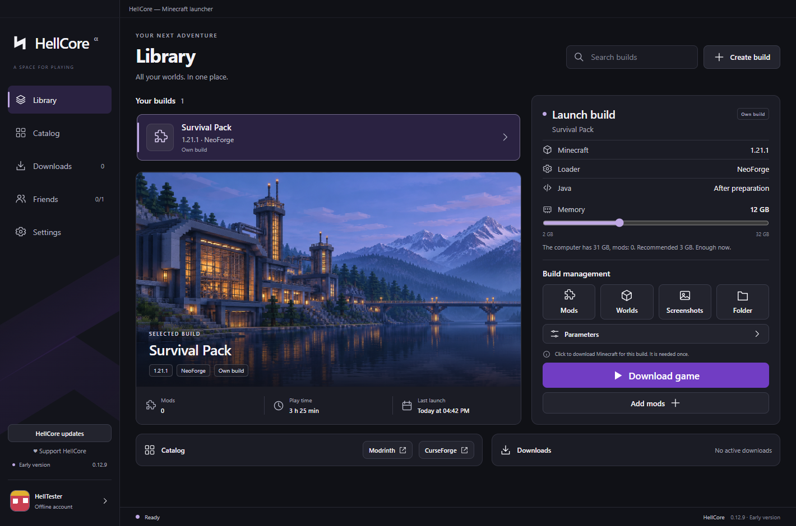
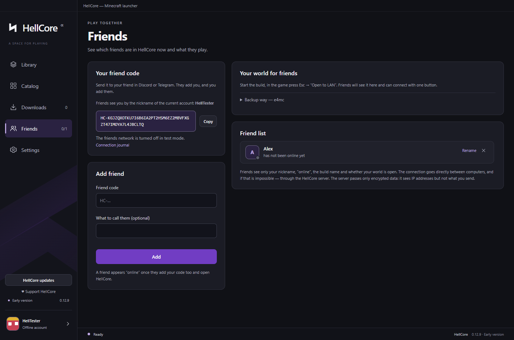
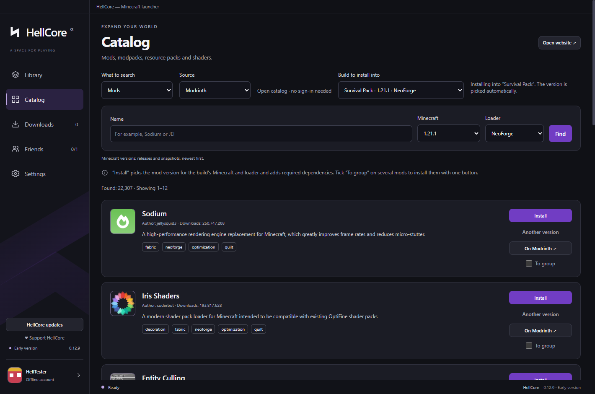

# HellCore — Minecraft launcher for playing with friends

**HellCore** is a free Minecraft launcher for Windows. Join your friend's world with one button — no server to rent,
no ports to open, no IP addresses to send around. Every build lives in its own folder and doesn't touch other launchers.

**[⬇ Download the latest version](https://github.com/HellCoreDev/hellcore-releases/releases/latest)** · Windows 10/11 x64 · free

## Why HellCore

- **Play with friends without setting up a server.** Add each other by friend code. When you open your world to LAN,
  your friend sees it in HellCore and joins with one button. HellCore sends the missing mods and the build automatically.
- **Works even when a direct connection doesn't.** If your internet provider blocks a direct link between you,
  HellCore connects you through the HellCore server. The data is encrypted end to end: the server sees IP addresses,
  but not what you send.
- **Big modpacks are comfortable.** Hundreds of mods open in a moment, with search, "working / switched off" filters
  and a duplicate check. **"Find what crashes the game"** narrows down a crashing mod step by step
  (about 9 launches for 500 mods), keeping required libraries on.
- **Your builds stay safe.** Backups of worlds and builds, "Update build" keeps your worlds, key bindings and your own
  mods, moving to another Minecraft version makes a copy.

## Features

- **Builds:** Vanilla, Fabric, Forge, NeoForge — any Minecraft version from alphas to snapshots. Own icon and
  background, window size, memory (with a hint), Java.
- **Catalog:** mods, modpacks, resource packs and shaders from Modrinth with required dependencies. CurseForge mods are
  downloaded through the browser and picked up automatically.
- **Mods:** search, filters, duplicates, one-click updates with a copy to go back, crash culprit search.
- **Friends:** friend codes, "online / playing" status, "Join" to an opened world, a connection journal.
- **Accounts:** Ely.by sign-in with a code (no keys or passwords in the launcher), Ely.by skins, offline accounts with
  your own skin.
- **Import** from other launchers (found automatically) and `.mrpack` files; share your own build.
- **"Continue in world"** (1.20+), screenshot gallery, play time, crash reason window, Discord status.
- **Russian and English interface**, any accent colour.
- **Updates by itself**, installs only signed releases.

## Install

1. Open **[the latest release](https://github.com/HellCoreDev/hellcore-releases/releases/latest)** and download one file:
   - **`HellCore-Setup-….exe`** — regular installer (recommended). No admin rights needed.
   - **`HellCore-Web-Setup-….exe`** — tiny installer (under 1 MB) that downloads HellCore itself.
   - **`HellCore-…-win-x64.zip`** — portable version: unzip and run `HellCore.exe`.
2. Windows may show **"Windows protected your PC"** on first launch: click **"More info" → "Run anyway"**.
   HellCore has no paid code-signing certificate yet.
3. HellCore downloads Minecraft and Java by itself. Create a build or import one from another launcher, and play.

Uninstall from Windows "Installed apps" — your builds, worlds and accounts are kept.

## Status

HellCore is in **early development** (0.12.x). What works and what is coming:

| | |
| --- | --- |
| ✅ Works | Builds, Modrinth catalog, mods, friends and "Join", HellCore server for friends, Ely.by and offline accounts, import, backups, updates |
| 🔧 In progress | Importing CurseForge modpacks from ZIP, clearer mod-compatibility messages, friend code backup |
| ⏳ Planned | CurseForge modpacks in the catalog (waiting for API access), Microsoft sign-in, Quilt |

If something doesn't work, please open an issue here or write to the author.

## Privacy

- Friends see only your nickname, "online", the build name and whether your world is open.
- The friend connection is encrypted end to end. The HellCore server only passes encrypted data when a direct
  connection is impossible; it sees IP addresses and friend codes, nothing else.
- Passwords are never stored by HellCore. Sessions are encrypted by Windows.

## Support

HellCore is free, with no ads and no paid features. You can support development on
**[Boosty](https://boosty.to/hellcore/donate)**.
